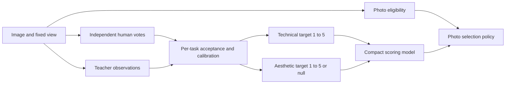

# Label specification for the image-quality pilot

Reviewed: 2026-10-16. Status: **proposed for a small rating trial; local tests are pending**. This document defines the proposed label meanings and values. It does not claim that a teacher, rubric, or training method has passed the pilot.

**Use technical quality as the primary target, on a continuous 1–5 scale. Keep aesthetics as a separate 1–5 target, initially limited to its own human audit. Keep photo eligibility as a separate boolean.** Do not combine these into one training label. Collect human votes as five ordered categories, retain each vote, and derive a fractional mean. Preserve continuous teacher predictions with their source and scale.

The first bulk synthetic-label run should enable only technical quality after its validation gate passes. An aesthetics field can exist while its value is null and its training mask is off. This narrows the earlier [two-task prompt proposal](synthetic-label-prompts.md); it does not change the saved prompt files or the immutable pilot manifests.

## 1. Research scope and confidence

The review began with the [Awesome IQA README](https://github.com/chaofengc/Awesome-Image-Quality-Assessment). Four research agents covered human rating scales, model targets, aesthetics and scope, and tests. A fifth agent checked the local data rules. Later rounds checked original papers, release cards, code, and conflicting results. Exa, Hugging Face, and Firecrawl were used; the [evidence ledger](exa-results/label-specification-2026-10-16.json) records the sources and tool limits.

| README branch | What it contributes | Decision for this pilot |
|---|---|---|
| No-reference IQA; IQA datasets | Image-alone technical ratings, human studies, compact predictors | Main task and source of scale evidence |
| Unified and explainable IQA | Five-word outputs, score distributions, scalar regression, short defect descriptions | Separate the collection format from the model output head |
| Image aesthetic assessment | Composition and appeal, viewer disagreement, aesthetic rating distributions | Separate target and validation gate |
| AIGC IQA | Perception, plausibility, preference, and prompt alignment | Do not import an overall generation score as pure technical quality |
| Spatial-aware and agentic IQA | Local defects and viewing-scale dependence | Fix image views; include local-defect and intentional-blur diagnostics |
| Full-reference IQA; perceptual similarity | Reference-conditioned distortion and preference | Useful controlled diagnostics; not absolute labels for arbitrary photos |
| Other topics and losses | Resolution, color, faces, 360-degree content, attacks, and training objectives | Relevant failure modes; no extra mandatory target for the first photo pilot |

The index is a discovery source. For example, its KADIS-700K row assigns 30 ratings per image, but the [original dataset page](https://database.mmsp-kn.de/kadid-10k-database.html) assigns those ratings to **KADID-10K**. KADIS supplies an unlabelled synthetic pool. We checked the underlying protocols rather than copying the index table.

The evidence strongly supports separate targets and label sources. Five human grades are a sound starting choice, with less certain support. No reviewed study proves that our teacher will work best with five words, decimal scores, or a 100-point prompt. That choice needs the small test in section 8.

## 2. Define the task before the scale

**Technical quality** means how clearly and cleanly the chosen image view shows its content. Assess loss of key detail from poor focus, noise, exposure faults, compression, and processing errors. Consider where a defect occurs, its size, and its effect. This is a rating of visible damage without a clean reference. It does not prove how closely the image matches the original scene.

**Aesthetics** means the visual appeal and coherence of the whole image: composition, hierarchy, framing, color, light, and visual expression. A simple image can be effective. An attractive subject is not sufficient evidence of good composition. Do not invent artistic intent or cultural context.

These targets can interact, but they ask different questions. [SPAQ's rater instructions](https://openaccess.thecvf.com/content_CVPR_2020/supplemental/Fang_Perceptual_Quality_Assessment_CVPR_2020_supplemental.pdf) tell people to judge technical quality apart from aesthetics. [NIMA](https://arxiv.org/abs/1709.05424) trains separate models for the two tasks. Our rubric follows that choice. Some other IQA studies ask for a broader overall rating.

**Photo eligibility** means whether an item meets the project's real-scene photo-selection rule. It is a policy label. It is not image quality, beauty, recognizability, safety, or proof of camera origin. The [existing boundary rules](../datasets/low-quality-and-controls.md#1-define-what-must-score-zero) remain the proposal: standalone charts, documents, interfaces, and known generated images are excluded; real scenes with incidental signs are eligible. A photo dominated by a reproduced chart is excluded. Unclear cases remain unknown.

## 3. Exact labels and values

| Field or record | Allowed values | Meaning and use |
|---|---|---|
| Human `technical_quality_grade` | Integer `1`, `2`, `3`, `4`, `5`; otherwise null with a reason | One person's technical judgment using the anchors below |
| Human `aesthetics_grade` | Integer `1`, `2`, `3`, `4`, `5`; otherwise null with a reason | Separate aesthetic judgment; collect only in the audit until promoted |
| `human_mos_1_5` per task | Real number in `[1,5]` | Mean of accepted independent human votes; retain full computed precision |
| `human_vote_counts_1_5` per task | Five nonnegative integers, ordered bad to excellent | Actual vote counts; their sum is the accepted rater count |
| `teacher_rating_1_5` per task | Real number in `[1,5]` | Model-derived judgment; never call it human MOS |
| Generic teacher v1 elicitation | `1.0, 1.1, …, 5.0` | Provisional prompt format already available; not a proven perceptual resolution |
| `model_level_probabilities` | Five nonnegative values summing to one | Only measured, complete label probabilities at the specified answer position; retain word order and extraction details |
| `photo_domain_eligible` | `true`, `false`, `null` | Eligible, excluded, or unresolved under the versioned photo policy |
| Accepted training scalar per task | Real number in `[0,1]`, or null | Derived from an explicitly selected, accepted target; `(score_1_5 - 1) / 4` |
| Per-task training mask | Boolean | True only when that task has an accepted target within its declared scope |

Do not overwrite one label source with another. An image can have human votes, a teacher rating, and scores from other models at the same time. Record which rating supplies the training target and how its scale was changed. Mixed human and teacher targets need a stated loss or weighting plan. Their average is not human MOS.

### Technical anchors

| Grade | Name | Definition at the specified viewing scale |
|---:|---|---|
| 1 | Bad | Severe visible defects dominate and make important content very difficult to see. |
| 2 | Poor | Major defects substantially damage important content, although some remains interpretable. |
| 3 | Fair | Noticeable defects reduce clarity or fidelity, but most important content remains visible. |
| 4 | Good | Minor defects have little effect on important content. |
| 5 | Excellent | Important detail is preserved, with no meaningful technical defect visible. |

These are whole-image judgments. Do not average blur, noise, exposure, and compression scores with fixed weights. More sharpness, brightness, contrast, or saturation is not always better. Background bokeh, film grain, monochrome, and low-key lighting need context. A clear subject with a soft background can merit a high technical grade; an unintentionally blurred subject can merit a low one.

### Aesthetic anchors

| Grade | Name | Definition within the visible medium and style |
|---:|---|---|
| 1 | Bad | The arrangement is strongly ineffective or incoherent. |
| 2 | Poor | Weak organization or distracting choices substantially reduce visual appeal. |
| 3 | Fair | Some choices work, but the visual result is limited or inconsistent. |
| 4 | Good | The elements work well together, with clear visual hierarchy and minor weaknesses. |
| 5 | Excellent | The whole image is exceptionally effective, coherent, and visually compelling. |

These five aesthetic categories are our proposed collection rubric. They are not the native ten-category AVA protocol. Do not force technical and aesthetic scores to agree or to have the same distribution.

[AADB](https://arxiv.org/abs/1606.01621) provides a relevant five-category aesthetic precedent, with five raters per image. It does not establish the reliability of our new rubric or teacher.

## 4. Why 1–5, rather than 1–100 or one hard class?

Five named categories give raters clear anchors and fit the existing Q-Align task vocabulary. However, the master target should retain fractional information. Votes `[3,4,4,4,5]` give a mean of `4.0` and counts `[0,0,1,3,1]`. A different vote set can have the same mean but different disagreement. Retain both.

| Representation | Evidence and limitation | Decision |
|---|---|---|
| One hard quality word | Q-Align shows that word-level training works for its trained LMM; a single word loses within-category detail | Comparison arm, not the sole retained target |
| Human five-category votes plus mean | [KonIQ](https://arxiv.org/pdf/1910.06180) uses five ordered quality grades and retains distributions | Default new human collection protocol |
| Continuous 0–100 ratings | [SPAQ](https://openaccess.thecvf.com/content_CVPR_2020/papers/Fang_Perceptual_Quality_Assessment_of_Smartphone_Photography_CVPR_2020_paper.pdf) shows a valid alternative | Preserve native source values; no need to change our scale solely to add digits |
| Continuous 1–5 teacher scalar | [Q-Insight](https://arxiv.org/abs/2503.22679) and other trained scorers use numeric outputs; our generic prompt has not been validated | Keep v1 tenths as the initial elicitation candidate |
| Rating distribution plus mean | [NIMA](https://arxiv.org/abs/1709.05424) and [DeQA-Score](https://arxiv.org/html/2501.11561v3) support distribution-based learning | Preserve real distributions; test the loss separately from data collection |
| Pairwise preference | Helps compare close images and learn ordering; does not alone identify an absolute scale | Auxiliary audit or later ranking loss, with ties and source links |

Five verbal grades are ordinal: they define an order. Arithmetic on their codes is a useful model choice. It does not prove that each step feels equally large to a viewer. A [direct rating-scale study](https://doi.org/10.1109/TBC.2010.2086750) found no overall statistical difference among several discrete and continuous scales, but it studied HD video. It does not prove which scale is best for our photos or teachers.

[ArtiMuse](https://huggingface.co/papers/2507.14533) uses a trained 101-token score head for 0–100 aesthetics. This is evidence that a supervised fine-grained scale can work, not that a general teacher prompt can make 101 reliable distinctions. Likewise, [LEAF](https://arxiv.org/html/2601.20689) uses actual label-token probabilities for compact-student supervision; it does not obtain human uncertainty by asking for JSON confidence.

Display conversions are exact arithmetic:

```text
score_0_1   = (score_1_5 - 1) / 4
score_0_100 = 25 * (score_1_5 - 1)
score_1_100 = 1 + 99 * score_0_1       # only if a product requires 1–100
```

Use 0–100 for a display if useful; keep it out of annotation collection. These transforms add no information. Do not round a human mean or a specialist's continuous prediction to tenths for storage. The v1 teacher's 0.1 step is only a bounded output format. Do not use a batch's observed minimum and maximum to stretch its scores.

### Q-Align compatibility is a separate adapter

[Q-Align](https://proceedings.mlr.press/v235/wu24ah.html) trains on five words and calculates a continuous expectation from their probabilities. For ascending levels, `score_1_5 = sum(p[k] * (k + 1))`. Store the actual wrapper, revision, weights, and scale: the [GitHub scorer](https://github.com/Q-Future/Q-Align/blob/main/q_align/evaluate/scorer.py) uses equivalent 0–1 weights, while other interfaces report 1–5.

The existing [Q-ReAlign-compatible adapter](synthetic-label-prompts.md#3-scale-and-training-conversion) uses bins `[1,1.8)`, `[1.8,2.6)`, `[2.6,3.4)`, `[3.4,4.2)`, and `[4.2,5]`. Thus `4.2` maps to `excellent`. This is **not** nearest-anchor rounding or a vote by a human who selected category 5. Preserve the raw scalar; use this conversion only in an explicitly named Q-ReAlign replication arm. Direct integer human grades map directly to their named categories.

Never fill missing top-k label probabilities with zeros. An API model that writes five probabilities into JSON supplies `elicited_level_weights`, not measured token probabilities or a human distribution. Repeated model outputs also remain model observations, not extra human raters.

## 5. Nulls, excluded images, and failure cases

| Case | Eligibility | Quality treatment |
|---|---|---|
| Badly blurred, noisy, dark, or unrecognizable real photo | True when its photo status is established | Valid low-quality candidate; rate the visible impairment |
| Clean chart, diagram, or known render | False under the photo policy | No forced low score. Use domain-only supervision in the first pilot; retain any valid broader-domain ratings separately |
| Known photorealistic generated image | False under the current selection policy | Exclusion comes from provenance; appearance alone cannot establish origin |
| Photo of a screen or paper chart | Apply the main-content boundary rule | Keep the decision reason; do not label all photographed objects alike |
| Decoded black frame from a known capture failure | True if photo provenance is established | Severe quality failure, not automatically an unreadable input |
| Blank graphic or uniform image of unclear origin | False or null, according to evidence | Review scope; do not infer a missing image or assign an automatic quality zero |
| Missing image or undecodable bytes | Unresolved if no other evidence | Null rating; record the input failure |
| API refusal, timeout, or malformed response | No new eligibility judgment | Failed attempt, not a low score or a neutral score |
| Aesthetics not requested | Unchanged | Null aesthetics value and false aesthetics mask |

In the saved app record, use per-task `status` values `ok`, `not_requested`, `out_of_scope`, or `unscorable`. `ok` requires a finite score in range. Every other state requires a null score and a reason. Keep request errors in a separate attempt log. A parsed score can still have `review_status: pending` or `rejected`. Only `accepted` can enable its training mask. Do not add these fields to the v1 model response without a new schema version.

An excluded image may receive zero from a **photo-selection policy**, while its quality remains unknown or high. An unknown photo-gate result must not become false. If selection uses quality after the gate, keep both the gate reason and the quality value. Never train the quality score against the policy zero.

## 6. Source scales, applications, and auxiliary labels

| Source or metric family | Native target or application | Import rule |
|---|---|---|
| KonIQ | Five-category image-alone quality votes | Retain votes, mean, count, and study/view identity |
| SPAQ | 0–100 quality and separate image attributes | Higher attribute values do not always mean better quality; noisiness is an example |
| [KADID](https://database.mmsp-kn.de/kadid-10k-database.html) | Reference-assisted degradation ratings; published `dmos.csv` is 1–5, **higher better** | Do not invert from the column name |
| [LIVE IQA](https://live.ece.utexas.edu/publications/2006/hrs-transIP-06.pdf) | Processed and realigned DMOS, **higher worse** | Preserve published direction and processing; do not assume raw rating bounds survive normalization |
| [AVA](http://www.cat.uab.cat/Public/Publications/2012/MMP2012/Murray2012.pdf) | Ten-category aesthetic votes | Aesthetics only; preserve its original histogram |
| [AGIQA-3K](https://arxiv.org/html/2306.04717v2) | Broad perception, including aesthetics and AI artifacts, plus alignment | Do not rename perception as our strict technical target |
| [RichHF](https://arxiv.org/html/2312.10240v2) | Separate plausibility, prompt alignment, aesthetics, and overall ratings | Keep each construct; prompt alignment needs the prompt |
| VizWiz defect votes | Named capture faults and unrecognizability | Auxiliary source labels; not MOS |
| Generated distortion parameters | Known operation and parameter values | Provenance; not an absolute score or guaranteed preference |
| PSNR, SSIM, LPIPS, DISTS | Comparison with a reference; restoration/compression diagnostics | Not image-alone human scores; a synthetic parent may already be poor |
| NIQE, BRISQUE, learned IQA predictions | Model estimates under a particular training/domain assumption | Baselines or teacher observations, never automatic human truth |

Source conversion must record the source ID, original value, native bounds, direction, protocol, and conversion version. The [UNIQUE](https://arxiv.org/abs/2005.13983) and DeQA work show why simple numerical rescaling does not align the perceptual meaning of independent studies. Use common anchors or study-specific calibration when needed. Keep within-source comparisons until cross-source alignment is justified.

Do not add one ambiguous `overall_quality` field. Do not require eight aesthetic attributes, regional heatmaps, AI-origin suspicion, or a long explanation for every pilot image. Preserve the defect votes and provenance we already have. A short visible-evidence sentence supports audits; it is not evidence that a rating is correct.

## 7. Views and record ownership

The target describes the **chosen image view**, not every possible crop, display, or size of the source file. Fix the orientation, color handling, resize rules, aspect ratio, provider image settings, and crop bounds. Keep the full image for composition. Show matched views for a parent and its damaged copy. Record source and delivered-pixel hashes, image sizes, rubric version, and processor version.

[PaQ-2-PiQ](https://arxiv.org/abs/1912.10088) links local and global quality while keeping their labels distinct. [Q-Probe](https://arxiv.org/html/2601.15356v5) shows why isolated crops can confuse natural background blur with damage. For the first trial, compare a full view against a full view plus fixed native-detail crops. Include clean crops as controls. Do not silently enhance the image or let an adaptive crop policy change the target between teachers.

The builder's frozen manifests reject non-null quality and aesthetics labels. Store new ratings and accepted targets in a **separate versioned artifact**, joined through fixed image IDs and view IDs. The model must not invent source details. The app records the model version, prompt hash, raw response, request settings, time, parse status, and review status. Human records retain a private rater ID, session, raw vote, and repeat status.

The flow is:



## 8. Small trial and promotion rule

This is a proposed trial. It is not a proven recipe or an approved rating run.

1. After the split review, use about 60 development images for rubric comprehension. Include ordinary clean photos, authentic severe faults, synthetic distortions, intentional effects, clean-but-dull images, expressive-but-imperfect images, and domain boundaries. Start with five independent human raters per applicable task. Use hidden repeats to assess consistency; repeats are not extra independent voters.
2. Revise ambiguous wording on that trial only. Then freeze the rubric and views. Assign disjoint source families to rubric development, calibration, and teacher selection. Trial families must not enter teacher selection. Collect evaluation votes under the frozen rubric; do not merge pre-revision and post-revision votes into one MOS. Keep the final test set untouched. Five raters are an initial budget, not a promise of precise MOS; increase ratings or report uncertainty where disagreement remains high.
3. On identical image IDs and views, compare v1 scalar elicitation with a five-word alternative. If complete label logits exist, test their expectation separately from a sampled word. Add a direct 0–100 teacher arm only as a bounded resolution check; map its output by a declared affine transform for comparison. Keep generation settings and exposure comparable.
4. Measure **SRCC** for order, raw **PLCC** for linear agreement, and **MAE** in 1–5 units after any mapping fitted only on calibration data. Report sample counts, coverage, failures, rater agreement, and source-family bootstrap intervals. Report mapped PLCC separately. Rounding or binning can create ties; only strictly increasing transforms preserve all ranks.
5. Also test close-pair ordering with `left_better`, `tie`, `right_better`, or `unscorable`. A tie means no meaningful perceived preference; unscorable means insufficient evidence. Check image-order reversal for joint judges, same-parent distortion severity, and same-subject selection. Do not manufacture a forced order from a tiny difference between uncertain means.
6. Before comparing teacher results, record acceptable regression margins for the intended selection use. Define acceptable versus unacceptable photo judgments independently, and choose any score threshold on calibration data only. On the teacher-selection subset, report false acceptance of severe defects and false rejection of acceptable photos, as well as domain-gate errors. Prefer the simpler format when no meaningful gain is demonstrated. Promote a finer scale only if it improves independent human agreement or useful ordering without a material regression on severe defects, intentional styles, or coverage. More distinct printed values are not a pass.
7. Promote aesthetics independently. If it fails, retain null aesthetics targets outside the human audit and train the technical scorer first. Do not spend on a second bulk label merely because the schema permits it.

Winning the format test is not enough for bulk labelling. Before we inspect model scores, the test plan must set limits for each task: minimum human agreement, maximum critical filtering errors, and minimum valid-output coverage. It must also state how uncertainty affects a pass. These use-specific limits have not yet been set or measured. Every teacher must pass them. If all fail, bulk labelling stays blocked while the teacher, rubric, or views are improved.

The recommended first student uses accepted continuous technical targets. Keep raw human histograms available for a later ordinal/distribution objective. Add pairwise supervision as a separate experiment. This preserves options while keeping the first training question small: can a compact image scorer predict human technical judgments on unseen photos?

## 9. Changes required before acquisition of labels

The v1 technical prompt is a suitable **candidate** for the small trial. Its numerical format is unchanged. Its aesthetics prompt is an audit candidate, not a default second bulk request. Both still require their own promotion evidence.

Next implementation work is the versioned observation/accepted-target schema, fixed-view preparation, human annotation interface or import, and label runner. No labels, schema migration, bulk inference, or training were performed in this review. Keep the current acquisition manifests and their hashes unchanged.
