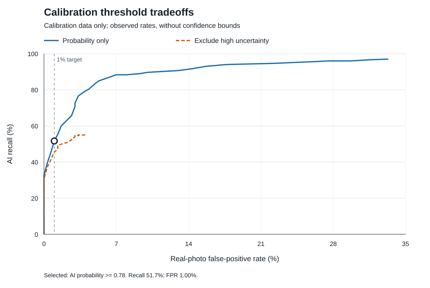

# Jev 1.14 calibration and held-out validation

Status: **complete**. Validation gate: **FAIL**. Generated: 2026-10-18T16:55:31.520903+00:00.

Frozen rule: **AI probability >= 0.78**. The rule was selected from calibration responses only. Validation responses did not alter it.

Flags enter a candidate queue. The Review column counts all remaining cases, which stay unresolved. Both queues require review; no case is accepted as a verified camera photo. This study does not authorize automatic rejection or deletion.

## Rule performance

The gate requires all validation cases to have valid responses, a one-sided exact 95% false-positive upper bound at or below 1%, and observed AI recall of at least 70%. Recall intervals are two-sided exact 95% intervals. The recall floor uses the observed rate, not its lower confidence bound.

### Calibration

| Rule | Real photos falsely flagged | FPR upper 95% | AI images flagged | Recall 95% interval | Review | Unresolved |
| --- | ---: | ---: | ---: | --- | ---: | ---: |
| Frozen selection | 3/300 | 2.56% | 155/300 | 45.85%–57.45% | 442/600 | 0 |
| Fixed 0.5 | 100/300 | 38.09% | 291/300 | 94.38%–98.62% | 209/600 | 0 |
| Fixed 0.8 | 1/300 | 1.57% | 119/300 | 34.09%–45.45% | 480/600 | 0 |

### Validation

| Rule | Real photos falsely flagged | FPR upper 95% | AI images flagged | Recall 95% interval | Review | Unresolved |
| --- | ---: | ---: | ---: | --- | ---: | ---: |
| Frozen selection | 3/500 | 1.54% | 259/500 | 47.32%–56.26% | 738/1000 | 0 |
| Fixed 0.5 | 167/500 | 37.04% | 480/500 | 93.89%–97.54% | 353/1000 | 0 |
| Fixed 0.8 | 2/500 | 1.25% | 198/500 | 35.29%–44.04% | 800/1000 | 0 |

The plot shows calibration results only. The circle marks the frozen rule; the dashed vertical line marks the empirical 1% selection target. Validation uses the stricter exact upper-bound gate.

Validation checks: `rule_selected`: pass; `both_classes_present`: pass; `all_valid`: pass; `fpr_upper_within_budget`: fail; `recall_meets_floor`: fail.

## Precision at different AI prevalence rates

These are scenarios using validation recall and false-positive rates. The dataset's balanced mixture is not an estimate of production prevalence. The second precision column substitutes the exact FPR upper bound while keeping observed recall; it is a sensitivity check, not a precision confidence interval. Zero observed false flags must not be read as perfect precision.

| Assumed AI prevalence | Precision from observed rates | Precision with FPR upper bound |
| ---: | ---: | ---: |
| 1.00% | 46.58% | 25.32% |
| 5.00% | 81.96% | 63.85% |
| 10.00% | 90.56% | 78.85% |
| 50.00% | 98.85% | 97.11% |

## Validation groups

Group results are descriptive. They do not establish a separate pass for each generator. Real-photo rows have no AI recall; generated-image rows have no real-photo false-positive rate.

| Generator/source class | Valid/total | AI flagged/total | Real false flags/total | Review |
| --- | ---: | ---: | ---: | ---: |
| DALL-E3 | 100/100 | 89/100 | 0/0 | 11 |
| Midjourney-v6 | 100/100 | 27/100 | 0/0 | 73 |
| SD2.1 | 100/100 | 46/100 | 0/0 | 54 |
| SD3 | 100/100 | 32/100 | 0/0 | 68 |
| SDXL | 100/100 | 65/100 | 0/0 | 35 |
| unknown | 500/500 | 0/0 | 3/500 | 497 |

## Cost and latency

| Split | Calls/expected | Reported cost (USD) | Calls without known cost | Median seconds | 95th percentile seconds | Input/output tokens reported |
| --- | ---: | ---: | ---: | ---: | ---: | ---: |
| calibration | 600/600 | 0.041575 | 0 | 0.545 | 0.846 | 989873/59400 |
| validation | 1000/1000 | 0.069292 | 0 | 0.551 | 0.834 | 1649803/99000 |
| total | 1600/1600 | 0.110866 | 0 | 0.548 | 0.842 | 2639676/158400 |

## Scope and limits

The source is [MS COCOAI](https://huggingface.co/datasets/Rajarshi-Roy-research/Defactify_Image_Dataset/tree/787334f7857fa54f29027a7f09c30e895ad486ef), from the pinned Hugging Face revision recorded in the protocol and manifest. Calibration uses the official `validation` split (300 real and 300 generated images); held-out validation uses the official `validation` split (500 real and 500 generated images). These are different caption families from one dataset, not a cross-source validation. Each sampled caption family contributes one real image and one generated image. Families are kept separate between the two study splits.

Pre-inference source correction: Before inference, the official test split was found to repeat caption/label rows in five image-variant blocks. The first block has reduced brightness. Both study splits therefore use different caption families from the official validation pool; the discarded preflight cohort is retained only in ignored acquisition evidence.

The [MS COCOAI paper](https://arxiv.org/html/2601.00553v1) links the dataset. The cohort covers five generators: SD2.1, SDXL, SD3, DALL-E3, and Midjourney-v6. One source, its generated-image mixture, and the delivered image resolution limit generalisation. This result does not establish performance on native camera files, other sources, newer generators, or production data. The repository card does not specify a dataset license. Paper licensing does not license the images; [COCO terms](https://cocodataset.org/dataset/termsofuse.htm) distinguish annotation licensing from the photos' source terms. Images remain in the ignored local data directory and are not redistributed with the report.

Native confidence for an uncertainty choice is not a separate probability that the origin decision is correct. This procedure selects a decision threshold; it does not fit calibrated output probabilities.

The cases are independent of our earlier prompt and benchmark cohorts. Overlap with Jev pretraining data is unknown, so this is not a claim that the model has never seen these public images. Calibration performance includes selection bias. Validation supplies the gate result. Exact class-level binomial bounds do not cover source shift or all forms of dependence; the paired family design must remain visible when interpreting aggregate results.

## Evidence

- [Machine-readable summary](summary.json), including ledger and protocol hashes.
- [Per-case results](cases.csv). Missing and failed cases remain in the denominators.
- [Calibration threshold curve](calibration-curve.csv). No validation threshold search was used.
- [Frozen selection](../selection.json), [protocol](../protocol.json), and [manifest](../manifest.json).
- [Acquisition audit](../acquisition-audit.json), including the acquired representation and source limits.

Acquisition limits recorded before inference:

- Caption normalization cannot prove capture-session or photographer independence; related scenes with different captions can remain.
- Perceptual hash can reject similar but distinct scenes and miss transformed duplicates.
- Both cohorts use distinct families from official validation. The official test split repeats each caption/label five times and its first block is brightness-reduced; it was excluded before model inference.
- Source resolutions and compression histories differ by generator; a shared delivery transform cannot remove these upstream cues.
- Dataset licence is not specified; paper CC BY4.0 is not an image licence. Keep image assets local and out of Git; commercial or redistribution rights are not established.
- Distributed parquet bytes are verified; this does not establish untouched camera or generator-output identity.
- No model outcomes, visual quality filters or detector scores were used for selection.
