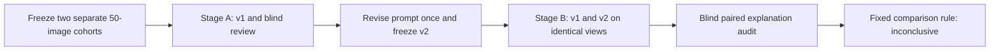

# DeepSeek prompt calibration: 50 development images and 50 test images

**The revised prompt improved the explanations, but did not establish better scores.** All 150 requests completed with valid 1–5 scores. On the separate 50-image test cohort, mean distance from the blinded review intervals fell by only 0.006 points. The paired 95% family-bootstrap interval was **−0.068 to +0.082**, so the predefined improvement rule did not pass.

Retain [visual-rating-v2](../../prompts/visual-rating-v2/technical-quality.txt) as an experimental prompt. It is not approved for bulk labels or training. The original prompt and all raw scores remain unchanged. These checks use assistant judgments, not human quality ratings.

## Results on the second 50 images

Lower distance and error counts are better. An interval hit means agreement with a subjective assistant review range; it is not measured human accuracy.

| Measure | Original v1 | Revised v2 |
|---|---:|---:|
| Valid, scorable outputs | 50/50 | 50/50 |
| Mean distance outside review interval | 0.380 | 0.374 |
| Mean absolute error against assistant point judgment | 0.614 | 0.616 |
| Scores inside review interval | 16/50 | 17/50 |
| Interval errors of at least one point | 7/50 | 8/50 |
| Explanations with material unsupported claims | 34/50 | 20/50 |
| Supported explanations | 14/50 | 26/50 |
| Uncertain explanation judgments | 2/50 | 4/50 |
| Unsupported compression claims | 22 | 3 |
| Noise misattribution flags | 9 | 2 |
| Unsupported repetition claims | 6 | 8 |

Every image received an explanation review. The report's `assessed` count includes definite true/false judgments; uncertain judgments remain null. Issue codes can overlap and can also identify omissions in otherwise supported explanations. They are not separate images or a quality score.

The revised prompt reduced specific error types without fixing score calibration. Distance improved by 0.050 on standalone Megalith images and 0.036 on VizWiz, but worsened by 0.033 on the controlled families. There were no new critical score contradictions under the predefined rule. Within the 12 adjacent synthetic-severity pairs, v1 had eight score decreases and four ties; v2 had nine decreases, two ties, and one reversal. This ordering is diagnostic because operator strength is not a human perceptual label.

Several cases show why the overall result remains inconclusive:

| Case | v1 → v2 | Visible finding |
|---|---|---|
| B41, clear storefront | 3.2 → 4.2 | The revised explanation removes unsupported heavy-smearing claims and recognizes clear detail. The reference interval is 4.6–5.0. |
| B08, severely blurred scene | 2.2 → 1.5 | The revised result better reflects the near-total loss of fine detail. The reference interval is 1.0–1.4. |
| B40, focused plant with a soft background | 3.2 → 2.5 | The new explanation still treats background defocus as a broad quality defect, despite visible subject detail. The reference interval is 4.2–4.8. |
| B22, monochrome market | 3.2 → 2.6 | The revised explanation claims heavy blur where produce, signs, and stall detail remain inspectable. The reference interval is 4.1–4.7. |

The primary assistant inspected these failure and improvement patterns after the blinded references were frozen. No reference or prompt was revised after the test outputs were opened.

## What changed after the first 50

Stage A produced 50 valid scores, but only nine fell inside the blinded reference intervals. Mean interval distance was 0.546 and point-judgment error was 0.800. Reviewers marked 31 explanations unsupported, 16 supported, and three uncertain. The model used 3.2 for 18 images and gave only one image a score above 4.

The revision adds visual signatures that separate noise, blur, compression, exposure loss, and obstruction. It requires evidence before claiming compression, repeated text, tiling, or global blur. It also clarifies the bad and excellent anchors and protects a clearly resolved subject from a penalty based only on background defocus. The construct, system prompt, response schema, numeric range, decimal steps, and null behavior stay the same.

The [revision lock](prompt-revision.json) binds the revised prompt to the stage-A observations, references, and audits. Its bundle hash is `cfe7313a8e4d011c7087c621dbbf60f9c5f663d50ce13cf27ffed129e9ab2233`. Stage-B images and results were not inspected by the prompt reviser before this lock was saved. No second revision was made using stage B.

## Design and cost

Each cohort contains six source parents, 18 controlled variants, 14 VizWiz images, and 12 standalone Megalith photos. The six controlled families cover blur, noise, and JPEG compression at three stored severity levels. Each cohort therefore has 50 images from 32 families. The [selection manifest](manifest.json) records all identities, hashes, roles, and exclusions.

The cohorts are separate from each other and the earlier 12-image pilot by source family, source and decoded hashes, and a conservative dHash check. All records come from the training split; stage B is held out for this prompt experiment, not a final model test set. The fixed views preserve the full frame within 1536 pixels. Preprocessing and duplicate checks reduce known confounds but do not prove complete independence.

Five blinded assistant reviewers rated ten images each in stage A. Five fresh reviewers did the same in stage B. References were frozen before provider outputs were inspected. For stage-B explanation review, each case used randomized X/Y arm names, balanced across 25 cases in each direction. The [arm mapping](audit-blinding.json), individual reviews, and merged audits are retained.



| Run | Requests | Reported cost |
|---|---:|---:|
| Stage A, v1 | 50 | $0.004938700 |
| Stage B, v1 | 50 | $0.005064500 |
| Stage B, v2 | 50 | $0.005138256 |
| Total | 150 | **$0.015141456** |

All responses identified `deepseek/deepseek-v4.1-flash-1017` and provider `Relace`. Settings were identical: temperature zero, reasoning disabled, 1024 output tokens, high image detail, and no provider fallbacks or automatic retries. Both stage-B runs used identical PNG bytes and ran concurrently. Costs come from returned OpenRouter usage; no attempt has an unknown cost. This experiment contains 100 new images, with 50 scored twice for comparison.

## Reproduce and inspect

The [protocol](protocol.md) fixes the analysis rule before scoring. The [summary](results/summary.json) contains metrics, gates, costs, and input hashes. The [case CSV](results/cases.csv) contains all 100 cases, both available model scores, reference intervals, explanations, and review flags. Original teacher observations and raw replies remain under `data/prompt-calibration-2026-10-18/`, outside Git.

From `visual-quality/`, verification and report reconstruction require the preserved local source images, derived subsets, fixed views, and raw run directories:

```sh
.venv/bin/python experiments/prompt-calibration-2026-10-18/prepare.py
.venv/bin/python experiments/prompt-calibration-2026-10-18/report.py --write
.venv/bin/python -m pytest -q tests experiments/prompt-calibration-2026-10-18/test_report.py
```

`prepare.py` verifies and reuses frozen artifacts and refuses changed inputs. `report.py` makes no provider requests; it verifies the saved runs, prompt versions, reference freeze records, and report inputs before rebuilding the summary. To inspect the recorded provider calls, use `visual-pilot verify-labels` with the corresponding `--views` and `--output` paths. Repeating `label` on these completed run directories reuses the saved results; a new directory can create new charges.

The runner now accepts an optional `prompt-version.json` with a `version` such as `visual-rating-v2`. Its content enters the prompt hash. Omitting it preserves the original v1 bundle hash. The implementation change prevents live resume under an older implementation hash, but old pilot records still pass read-only verification.

The next useful comparison is another teacher or a separate vision-provider path on these same frozen views, followed by independent human anchors. This experiment does not determine whether the remaining errors originate in the model, provider image handling, or the rubric. All training masks remain false.
