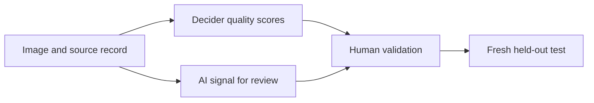

# Visual triage: initial model comparison

**Follow-up complete:** the [new validation](VALIDATION.md) found that Decider detected only 6/40 low-quality images. Luna reached 85.0% accuracy on matched photos; a GEPA prompt reached 88.3% at 51% more cost, with uncertain gain. Those results qualify the recommendations below. This report preserves the initial panels and their evidence.

**Evaluation complete, 11 October 2026. Decider v1.1 is the best quality-scoring candidate in this test:** it had the lowest score error, cost and latency. Luna is the better-value AI-review candidate than Gemini: it detected one fewer generated image at about one tenth of the cost. None of the models is ready for automatic content rejection.

All three models returned valid results for **60 quality/aesthetics images and 60 separate AI-origin images**. Including development, the expansion made 696 calls for **$0.3109** in reported inference cost. All 150 image assessments are saved. Validation passed: 79 tests, image and request hashes, lint and formatting.

## Quality and aesthetics

Errors below compare each model with the assistant's saved assessments on a 1–5 scale. Lower mean absolute error (MAE) is better. Human MOS is the dataset's mean opinion score; its rank correlation provides a separate check.

| Model | Quality / aesthetics MAE | Human MOS rank correlation | Cost for 60 | Median / P95 latency |
| --- | ---: | ---: | ---: | ---: |
| Decider v1.1 | **0.208 / 0.204** | **0.658** | **$0.001196** | **0.604 / 0.940 s** |
| GPT-6 Luna | 0.322 / 0.238 | 0.348 | $0.007524 | 1.848 / 3.180 s |
| Gemini 3.8 Flash | 0.583 / 0.452 | 0.579 | $0.092508 | 3.199 / 11.399 s |

Decider offers the strongest measured trade-off for this task. Quality and aesthetics also remain distinct: it scored the dark doorway in `quality-039` at 2.58 for quality and 3.97 for aesthetics. Clean graphics and renders can score well; photo eligibility needs a separate check.

The main limit is the dataset. These 60 UHD-IQA images have no human scores below 2.6/5, so they cannot establish recall for rejecting bad images. Human quality ratings were collected at 3,840 pixels; models saw 512-pixel views, which can hide defects. The scale conversion does not correct that difference. **Human aesthetic ratings are unavailable.** Assistant scores are model judgments, not human ground truth.

## AI-origin detection

The reference labels come from dataset provenance: 30 real DOCCI photos and 30 generated images. We fixed the AI threshold at 0.5 before testing. The photo-like subset uses the assistant's saved medium labels.

| Model | AI detected | Photo-like AI detected | Real falsely flagged | Cost for 60 | Median / P95 latency |
| --- | ---: | ---: | ---: | ---: | ---: |
| Decider v1.1 | 16/30 | 5/18 | 0/30 | $0.001484 | 0.648 / 0.998 s |
| GPT-6 Luna | 20/30 | **10/18** | 0/30 | $0.009377 | 3.014 / 4.747 s |
| Gemini 3.8 Flash | **21/30** | 9/18 | 0/30 | $0.094588 | 3.263 / 9.328 s |

Luna is worth retaining for AI review. Its extra detections over Decider matter, especially on photo-like images, while Gemini's extra cost bought only one additional detection overall. These small count differences do not establish a general model ranking.

Decider ranked generated images well (AUROC 0.982), but its fixed-threshold recall was weak. Treating scores at or below 0.2 as an automatic pass would admit eight generated images with Decider and six with Luna. Gemini placed 56/60 images in the fixed review band, `0.2 < p < 0.8`, leaving little automatic coverage.

The real class contains casual photos; 12 generated examples are graphics or renders. This mismatch can reward style cues. Most acquired images were re-encoded by the Dataset Viewer, so this is not a test of native camera files. Zero false flags in 30 real photos still allows an **11.4% false-positive rate at the upper 95% confidence bound**, before accounting for source bias. No automatic rejection threshold is validated. NSFW detection also remains untested on confirmed positive examples.

## Prompt selection

Four Decider rounds used the original 30 development images: 21 for tuning and nine for checks, with known parent images kept together. All prompts were fixed before the new images were inspected.

| Round | Change | Quality check MAE | AI-suspicion tune MAE |
| --- | --- | ---: | ---: |
| 1 | Baseline with separate scores | 0.353 | 0.134 |
| 2 | Clarify defects and missing evidence | 0.310 | 0.122 |
| 3 | Add detail and composition guidance | 0.291 | 0.126 |
| 4 | Shorten quality rules; refine origin cues | 0.369 | 0.121 |

The [quality prompt](prompts/final/quality.json) uses round 2. Round 3 had lower check error, but round 2 met the preset 0.05 tie rule and was shorter. The [AI prompt](prompts/final/ai.json) uses round 4. These errors measure agreement with the assistant, not human or provenance accuracy; the nine checks have no binary AI labels. The original assessments were already exposed to earlier results.

Gemini and Luna use the selected **low** setting with a 4,096-token output cap. Decider has no equivalent control. The [freeze record](evidence/benchmarks/freeze.json) preserves the exact configuration. No prompt or threshold was changed after final results became visible.

## Cost at scale

Quality and aesthetics share one request; AI origin uses another. These estimates extend the measured cost of the same prompts and 512-pixel views.

| Model | Quality + aesthetics, 250K images | AI origin, 250K images | Both tasks |
| --- | ---: | ---: | ---: |
| Decider v1.1 | $4.98 | $6.18 | **$11.16** |
| GPT-6 Luna | $31.35 | $39.07 | $70.42 |
| Gemini 3.8 Flash | $385.45 | $394.12 | $779.57 |

Final evaluation cost **$0.2067**; development brings the expansion to **$0.3109**. Luna's BYOK upstream costs are included despite its zero OpenRouter charge. Estimates exclude acquisition, storage, retries and human review; verify current prices before scaling. Latency includes network time and overlapping task runs, so it is an observed client comparison, not an isolated serving test.

## Validation proposed from this test

The next pass tested Decider on low-quality images and Luna on matched real/generated photos; see the [completed follow-up](VALIDATION.md). Human aesthetic ratings, human-made graphic/render controls and a Decider-to-Luna cascade still need separate validation.

This is a proposed validation path. Keep low-quality examples needed to train the scorer; do not remove them under a gallery-quality policy.

## Evidence and reproduction

All models received identical full-frame JPEGs. Source labels and assessments were excluded from requests. New assessments were saved before calls, with per-image labels hidden; exact duplicate checks found no overlap across the three panels. Public-data exposure during model training remains unknown.

[Per-image results](summaries/initial_benchmark.csv) · [Compact metrics](summaries/initial_benchmark.json) · [AI slices](ARCHIVE.md) · [Original assessments](evidence/assessments/original-30.md) · [Run commands](README.md)

The [quality source note](benchmark_data/quality-research.md) documents CC0 photos, missing aesthetic labels and the source certificate exception. The [AI source note](benchmark_data/ai-research.md) documents provenance, re-encoding and non-commercial terms. Both retain the Exa and Hugging Face research links. The [earlier 30-image report](REPORT.md) records the initial provider and pipeline checks.

Archived source snapshots and raw records require [archive restoration](ARCHIVE.md). The guide identifies the original paths and hashes.

The compact exports are derived results. Restore the [full evidence archive](ARCHIVE.md) to validate raw responses or rebuild reports. CSV phase and panel fields identify each comparison.
