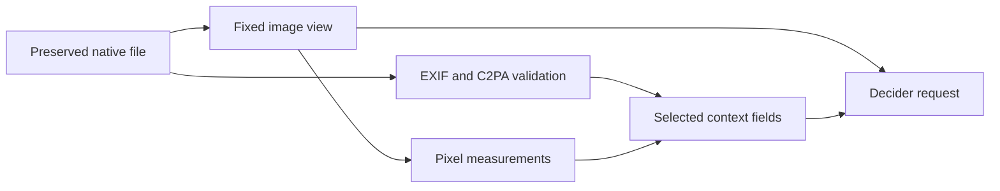

# Native metadata trial

This completed trial tests whether image metadata helps Decider detect AI images. The [report](report.md) compares seven input variants after 20 GEPA proposals each, with accuracy, cost, latency and per-image results. Native tests and metadata controls remain separate.

The native set has equal numbers of real and AI images, but metadata coverage differs by source. All 20 usable C2PA AI claims in the held-out set come from Firefly; the other 60 AI images have no manifest. Camera settings occur only in real photos. This collection cannot establish performance with equal metadata coverage across classes. Separate controls remove or swap metadata while image pixels stay fixed.

| Input variant | Extra context |
| --- | --- |
| `image_only` | None |
| `resolution` | Native and delivered dimensions and aspect ratios |
| `camera` | ISO, exposure seconds, f-number and focal length; missing values remain null |
| `tone` | Luma percentiles, tonal spread, clipping fractions and RGB moments |
| `texture` | Adjacent luma differences, Laplacian variance and luma entropy |
| `provenance` | C2PA presence, signature, content binding, signer trust and declared origin |
| `all_context` | All five context groups |

The separate control panel contains 700 cases: 160 each for camera stripping, camera swapping, native-resolution stripping and combined stripping, plus 20 each for C2PA stripping, manifest copying and signature damage. Camera donors form a one-to-one permutation within the test split; both recipient classes receive equal counts from each camera group and generator. Camera, resolution and combined stripping change the supplied context only; they do not rewrite native EXIF. The C2PA controls alter credential bytes and run the validator again. All 60 C2PA byte controls preserve decoded pixels and pass their expected validation checks.

Camera values are editable claims. Pixel measurements are descriptive statistics, not calibrated forensic scores. C2PA validation establishes signature and binding results under a fixed trust policy. It does not prove that an issuer's claim or a depicted scene is true. Neither missing EXIF nor absent C2PA proves AI origin.

The [paper review](../../research/metadata-2026-10-12/paper-and-design.md) explains why these measurements do not reproduce AIDE. Source notes cover [native real files](../../research/metadata-2026-10-12/real-sources.md), [generated files](../../research/metadata-2026-10-12/ai-sources.md) and [credential validation](../../research/metadata-2026-10-12/c2pa-sources.md).

## Frozen experiment

The frozen cohort contains 320 images: 80 training, 80 development and 160 final cases, with equal classes in each split. Real images come from the native VISION collection. Generated images come from the authors' Synthbuster archive. Acquisition retains original bytes, rights records and source hashes. A visual review checked photographic medium and excluded recognised cross-split locations before the manifest was frozen. Fresh cases are unused in earlier local panels; overlap with provider model training is unknown. The four generator families come from the older Synthbuster release, so this trial does not measure detection of the latest generators.

All arms receive the same 512 × 512 centre crop, encoded as JPEG at quality 95 with no chroma subsampling. EXIF and C2PA are read from the native file before this conversion. The validated native credential does not sign the derived JPEG sent to the model. Filenames, producer names, camera identities, captions, GPS, timestamps and gold labels stay outside model context.



Each arm uses the same starting prompt and 20 GEPA proposal attempts. Luna supplies reflection at its fixed `low` setting, using at most four training images. Complete source groups determine evaluation reward. Development reward selects the prompt, with a minimum improvement of 0.005 in `1 - Brier loss`; the AI threshold remains 0.5. All seven selections must be frozen before final or control calls.

The final test evaluates both the shared starting prompt and each selected prompt. An unchanged selection reuses its starting-prompt responses. This separates the effect of added metadata from the effect of prompt search. The global spend guard is $5, with a $0.65 known-spend limit and a 5,000-task-call limit per arm, and four concurrent requests. The global guard includes known costs, allowances for unresolved charges and all pending request reserves. Failed calls remain in the ledger.

Some failures returned no response ID or usage record, so their actual charges remain unknown. The [first amendment](cost-recovery-amendment.json) reserves $0.05 per eligible Decider connection failure; the [second](cost-recovery-reallocation.json) changed the allocation between arms; the [third](cost-recovery-timeouts.json) extended the same rule to read timeouts. The [fourth amendment](cost-recovery-shared-pool.json) funds unresolved allowances from the shared $5 limit and applies a $0.65 known-spend guard to every arm. The [fifth](cost-recovery-http-errors.json) adds strictly checked HTTP 500/502/503/504 error responses. These allowances are planning estimates, not recorded charges or proven billing ceilings. Failed requests are not retried. Each new failure batch stops for a network check. Frozen prompts, images, selection rules and original response files remain unchanged.

## Run and verify

Use the project environment from `visual-triage`:

```sh
uv sync --locked --group dev --group optimisation --group metadata
uv run --locked --group metadata --group optimisation python -m pytest tests -q
```

Git retains code, protocols, selected prompts, source notes and per-image outcomes. The full dataset, control manifest, summary, downloads and raw responses stay ignored. Restore that evidence before running an audit. Image validation also needs the local image cache. Do not regenerate an accepted manifest or overwrite frozen inputs: `study.py` checks source, view, feature, prompt and execution-code hashes.

The saved study and all five operational amendments are already frozen. Load `OPENROUTER_API_KEY` through the shell environment and use a shell with working network access. Resume each phase in order:

```sh
uv run --locked --group metadata --group optimisation python tracks/metadata_v3/resume_http_errors.py optimise --diagnostics data/metadata-v3/diagnostics/transport.jsonl
uv run --locked --group metadata --group optimisation python tracks/metadata_v3/resume_http_errors.py final --diagnostics data/metadata-v3/diagnostics/transport.jsonl
uv run --locked --group metadata --group optimisation python tracks/metadata_v3/resume_http_errors.py controls --diagnostics data/metadata-v3/diagnostics/transport.jsonl
uv run --locked --group metadata --group optimisation python tracks/metadata_v3/report.py --controls tracks/metadata_v3/controls.json
uv run --locked --group metadata --group optimisation python tracks/metadata_v3/request_audit.py
```

Re-running an inference phase resumes its saved attempts; it does not repeat completed requests. Optimisation cannot resume after a final or control call. The report and request audit are offline. They need saved raw ledgers, not just the compact CSV. The audit reconstructs each request and publishes example metadata text without image bytes; its hashes verify local request construction, not what the provider internally used.

For a separate study, use a new directory and `study.py freeze` after reviewing the new inputs. Do not overwrite this study's protocol or amendments. The local evidence bundle preserves raw responses, metadata and source captures with a checksum; image files remain outside that archive and have separate inventory hashes.

The [bundle receipt](evidence-bundle.json) names two local files: `evidence.tar.gz` and `index.json`, both under `data/metadata-v3/evidence-bundles/final-v2/`. They are unpublished. A fresh clone must obtain both files and place them at those paths. Then verify the archive and restore only ignored evidence:

```sh
python tracks/metadata_v3/evidence_bundle.py verify
python tracks/metadata_v3/evidence_bundle.py restore --evidence-only
```

This restores the dataset, controls, full summary and raw evidence while preserving current code and reports. Restore verifies the complete archive, skips identical files and rejects conflicts. To inspect the original code and reports as well, use a fresh directory:

```sh
python tracks/metadata_v3/evidence_bundle.py restore --destination /private/tmp/metadata-v3-snapshot/visual-triage
```

The archive excludes image bytes and is not an image backup. Frozen receipts retain historical absolute paths; restoration into another checkout does not make every historical command portable. Inspect the restored evidence there, or use the original checkout and image cache for replay.
